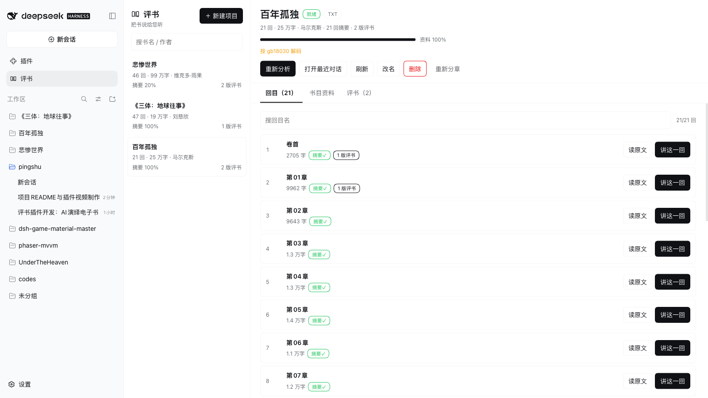
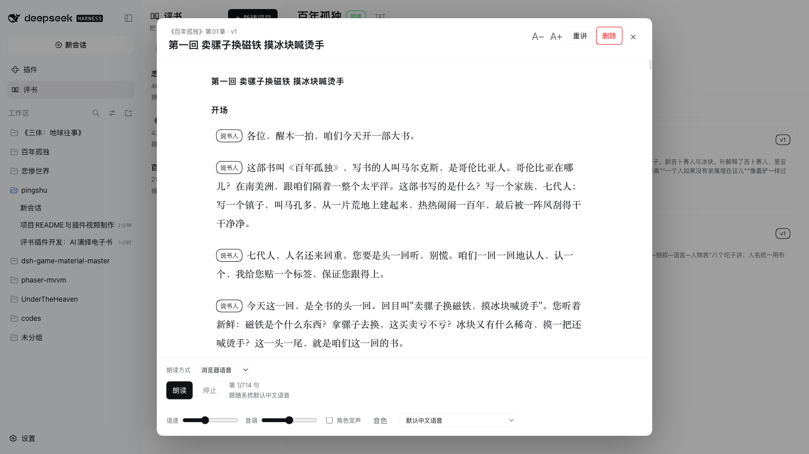
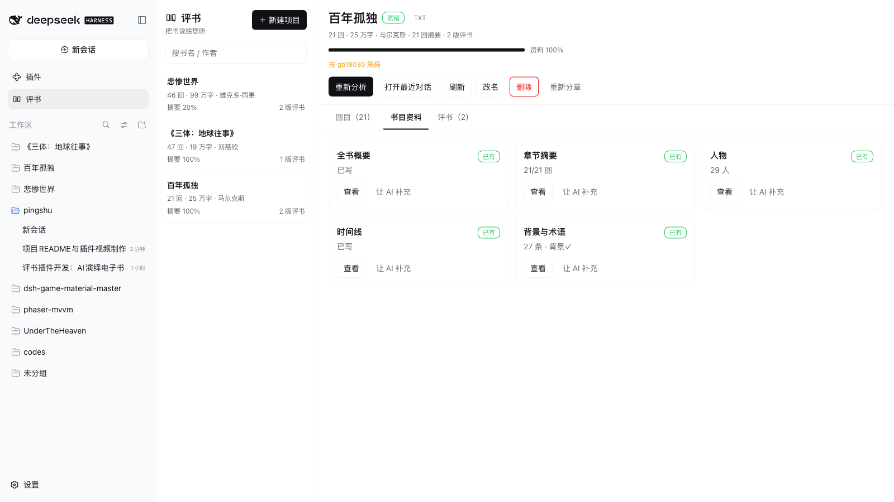
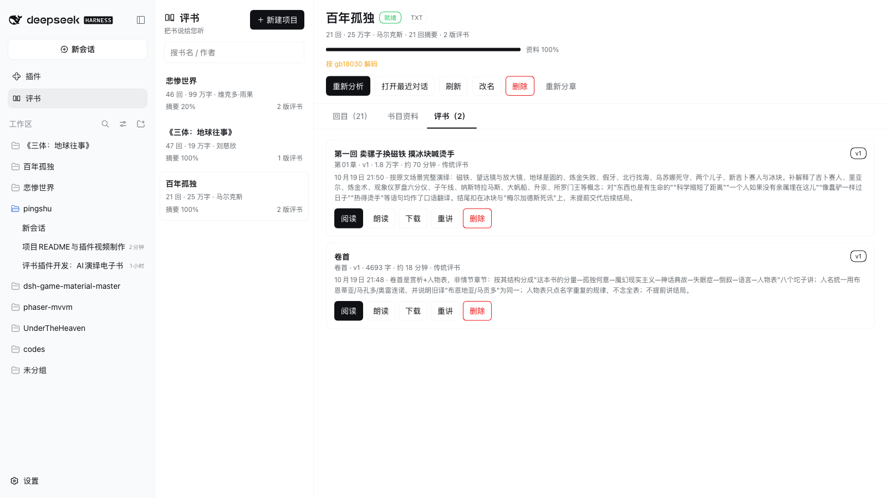

<div align="center">


# 评书 · dsh-pingshu

**把电子书拆成回目，用中国传统评书讲给你听。**

[](https://github.com/universe-st/dsh-pingshu-plugin)
[](LICENSE)
[](package.json)

[安装](#安装) · [快速上手](#快速上手) · [功能](#功能) · [演示](#演示) · [界面](#界面) · [朗读](#朗读) · [数据](#数据目录) · [开发](#开发与自检)

</div>

---

<p align="center">
  
</p>

## 这是什么

一本书，少则十几万字，多则上百万字。翻开第一页，人名一大串、地名一大片，读了十页还在认人——很多人就是这样把名著放回书架的。

**评书**是 DeepSeek Harness 的一个插件。它把一本电子书拆成回目，让 AI 先读懂人物、时间线和背景，再按中国传统评书的讲法把这一回讲出来。你得到的不只是“缩写”，而是一段能听、能读、有扣子的评书：

> 百年风雨一座城，七代儿孙一盏灯。
> 灯灭城空人散尽，纸上犹闻打雷声。
>
> 四句歪诗念罢，醒木一拍——各位，咱们今天开一部新书，《百年孤独》。

书还是那本书，只是这回，有人在桌子后头替你讲了。

## 功能

- **多格式导入**：EPUB / PDF / TXT / Markdown。EPUB 优先读目录与书脊，PDF 优先读书签，TXT / Markdown 识别标题行；识别不到时按段落长度兜底分章。
- **书目资料**：每本书生成全书概要、章节摘要、人物小传、时间线、术语表和时代背景，分目录保存，随时可查、可补、可手改。
- **评书文案**：按回目生成完整评书，包含开场定场诗、正文、扣子和下回预告；每版单独保存（v1、v2…），旧版不覆盖。
- **不设字数上限**：不讲“十分钟带你读完”，按故事完整度讲完；想短一点，可以在开讲时选时长和讲解力度。
- **写给耳朵听**：内置《评书表演手册》，要求把原文里的格言、警句、比喻翻成大白话，避免“听着高级但没懂”。
- **四种朗读方式**：浏览器语音、火山引擎豆包、硅基流动、MOSS-TTSD 本地服务，按需切换。
- **全部在本机**：书、摘要、文案、TTS 缓存都在 `$DSH_HOME/pingshu`，不上传云端；Markdown / JSON 可直接阅读和备份。

## 演示

[](https://github.com/universe-st/dsh-pingshu-plugin/releases/download/v1.0.0/pingshu-promo.mp4)

[观看 2 分 15 秒的插件介绍片（1080p）](https://github.com/universe-st/dsh-pingshu-plugin/releases/download/v1.0.0/pingshu-promo.mp4)。片中的评书片段，来自本插件实际生成的《百年孤独》卷首与《悲惨世界》卷首。

## 界面

<p align="center">
  
  
</p>

<p align="center">
  
  
</p>

## 安装

评书是一个 DSH bundle。在 DSH 里用插件管理器安装：

```text
plugin_manager install_bundle { target: "/path/to/dsh-pingshu" }
```

或在命令行：

```bash
dsh plugin --profile web add /path/to/dsh-pingshu
```

安装后刷新 Web GUI，侧栏会出现「评书」图标。

> **要求**：DSH `>=0.2.1-rc.2 <0.3.0-0`。仓库内的 `node_modules` 已在 `.gitignore` 中忽略，安装时由 DSH 自行解析依赖。

## 快速上手

1. 侧栏点「评书」→「新建项目」。
2. 选择电子书，填写书名、作者，点「导入并开始分析」。
3. 导入完成后会自动打开一个「书目分析」对话。分析一次做完：AI 用 `pingshu_analysis_batches` 分批，再开子代理并行读章节、写摘要，最后汇总全书资料；不需要你反复回「继续」。
4. 回到面板，挑一回，点「讲这一回」，选时长、风格和讲解力度。
5. AI 会先读手册，再读资料包和原文，写完自动保存。到「评书」页签点朗读，或者直接读文字。

一个项目就是一个工作区。导入、分析、讲某一回都会各自开一个新对话，互不打断。

## 面板

| 页签 | 你能做什么 |
| --- | --- |
| **回目** | 看全书回目和字数；读原文；对某一回点「讲这一回」 |
| **书目资料** | 看全书概要、人物、时间线、背景与术语；缺哪块让 AI 补 |
| **评书** | 看历史版本；阅读、朗读、下载、重讲、删除；切换朗读方式 |

阅读器按评书段落分块朗读，长回会自动分段合成，不用一口气等完整本。

## 朗读

| 方式 | 要不要 Key | 说明 |
| --- | --- | --- |
| **浏览器语音** | 不需要 | 用系统自带的中文语音（Web Speech API）。装什么音色就用什么音色；浏览器不提供音频导出 |
| **火山引擎豆包** | 需要 | 走单向流式 TTS HTTP 接口，按字符计费；预置音色用 `seed-tts-2.0`，复刻音色用 `seed-icl-2.0` |
| **硅基流动** | 需要 | 托管 MOSS-TTSD-v0.5，OpenAI 风格 `/v1/audio/speech`；支持 `SILICON_FLOW_API_KEY` 环境变量 |
| **MOSS-TTSD** | 不需要（要本机服务） | 开源的 1–5 人长对话 TTS，需自己起 SGLang 推理服务；支持参考音频克隆音色 |

配置都在阅读器底部「配置」里。API Key 只保存在本机 `tts/tts.json`（权限 600），不会回传浏览器，也不会写进文案。测试连接和正式合成都会计费。

## 数据目录

```text
$DSH_HOME/pingshu/projects/<projectId>/
  project.json                    # 书名、作者、格式、回目索引
  source/book.epub|pdf|txt|md     # 原始文件
  text/book.txt                   # 抽取出的纯文本
  chapters/ch-000001.md           # 按回目切好的正文
  summaries/book.md               # 全书概要
  summaries/chapters/*.md|*.json  # 章节摘要与要素
  characters/index.json|*.md      # 人物小传
  timeline/timeline.json|*.md     # 时间线
  background/glossary.json|*.md   # 术语表
  background/context.md           # 时代与背景
  performances/ch-000001/v1.md    # 评书文案，每版一个文件
  tts/tts.json                    # TTS 配置（含 Key，权限 600）
  tts/refs/*.wav                  # MOSS-TTSD 参考音频
  cache/tts/<hash>/*              # TTS 合成缓存
```

默认 `$DSH_HOME` 是 `~/.dsh`。所有内容都是普通 Markdown / JSON，可以直接看、直接改；改完在面板点「刷新」会对账。

## 工作方式

```text
电子书 ──▶ 解析 / 分回 ──▶ 逐回摘要 ──▶ 全书资料（人物·时间线·背景·术语）
                                             │
                              ┌──────────────┘
                              ▼
                         《评书表演手册》
                              │
                              ▼
                     评书文案 v1 / v2 / …  ──▶ 阅读 / TTS 朗读
```

- **分析**用 `pingshu_analysis_*` 和 `pingshu_save_*` 工具，分批并行，一次做完。
- **开讲**先取紧凑资料包，再读原文；长回分段读，避免只凭摘要编情节。
- **写作**遵循 `prompts/performance.md`：结构、扣子、人物对话、降低门槛、输出格式都写在里面。

## 工具

插件向 DSH 暴露 14 个 `pingshu_*` 工具，覆盖定位、读原文、读资料、分批分析、保存摘要 / 全书资料、保存评书文案和查历史版本。模型不需要知道文件路径，也不需要直接改 `project.json`。

## 开发与自检

```bash
npm test                       # 解析、存储、TTS、提示词等单元测试
node scripts/verify-wire.mjs   # host / client / gateway 方法面一致
node --check lib/index.js lib/client.js
```

安装后可以用 `cordis_inspect_query` 检查：

- `Config.listConfigs` 里的 `pingshu` 行
- `Slots.listSubTree` 的 `main` key=`pingshu`、`sidebar.panellist` id=`pingshu`
- `Tool.listTools` 里的 14 个 `pingshu_*` 工具

写作方法在 `prompts/` 下，都是普通 Markdown，改完重启 Host（或等 HMR）即可生效：

- `prompts/performance.md`：评书表演手册
- `prompts/analysis.md`：书目资料整理手册
- `prompts/accessibility.md`：降低阅读门槛的通用原则

参考来源见 [`docs/REFERENCES.md`](docs/REFERENCES.md)。

## 限制

- **扫描版 PDF 不做 OCR**：没有文字层会提示先转文字版；DRM 加密书、密码 PDF 不支持。
- **PDF 版面不保证**：多栏、表格、特殊字体可能抽错行；面板会警告，可在对话里让 AI「重新分章」。
- **浏览器语音不能导出**：要音频文件请用火山豆包、硅基流动或 MOSS-TTSD。
- **TTS 不内置音色列表**：Speaker ID / voice 以各家控制台为准；不同资源对应不同音色集合。
- **文案质量取决于模型与书**：写文案前会读手册，但长书、难书仍可能出现取舍偏差，建议先试听一回再批量生成。
- **按本地单用户设计**：如果开启远程访问，请自行确认 DSH 的访问控制。

## 常见问题

**Q：为什么导入后没有马上出评书？**
A：导入只做解析和分章。书目分析是一次性任务，会在新对话里跑完；分析完成后才可以开讲。

**Q：能只讲某一回、不分析全书吗？**
A：可以。但人物、时间线和背景会薄一些，跨章节的伏笔容易接不上。建议至少让分析把当前回和前后各一回覆盖到。

**Q：评书文案能改吗？**
A：能。文案就是 Markdown，直接在 `performances/<回目>/vN.md` 里改；重讲会生成新版本，不会覆盖你改过的旧版。

**Q：卸载会删书吗？**
A：不会。卸载只移除插件，`$DSH_HOME/pingshu` 里的书和文案保留；要清理请手动删除该目录。

## 致谢

- 评书的结构与说法参考了传统评书的常见套路：定场诗、开脸儿、扣子、下回分解。
- 朗读能力来自 [火山引擎豆包语音](https://www.volcengine.com/product/voice-tech)、[硅基流动](https://siliconflow.cn)、[MOSS-TTSD](https://github.com/OpenMOSS/MOSS-TTSD) 与浏览器 Web Speech API。
- 感谢 DSH 插件生态里的同行为 bundle / slot / wire 协议留下的示例。
- 宣传片里的评书片段，分别来自本插件实际生成的《百年孤独》卷首与《悲惨世界》卷首；BGM 由 [muse.top](https://muse.top) 提供。

## License

[MIT](LICENSE) © 2026 huanyu
